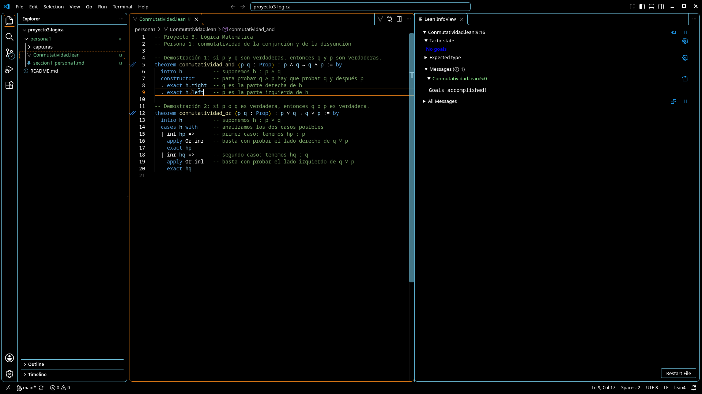
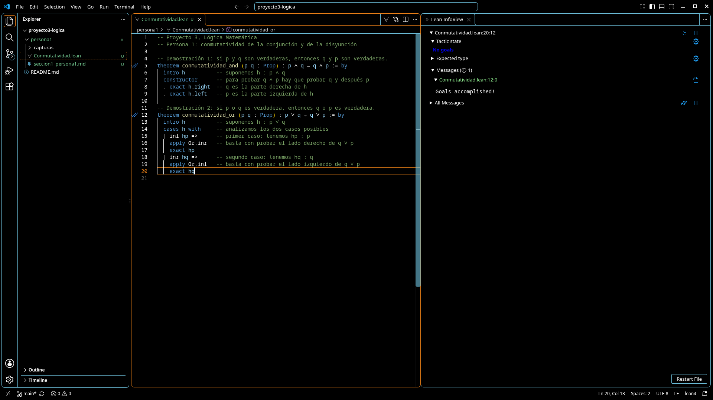

## Demostraciones

Ambas demostraciones están en el archivo `Conmutatividad.lean`. Se escribieron en modo de tácticas y solo usan lo que trae Lean por defecto, sin bibliotecas adicionales. En ellas, p y q representan proposiciones cualesquiera, lo que en Lean se escribe `(p q : Prop)`.

### Demostración 1: conmutatividad de la conjunción

**Enunciado:** p ∧ q → q ∧ p

**Razonamiento en lenguaje natural.** Supongamos que p ∧ q es verdadera. Por la regla de eliminación de la conjunción (simplificación), de p ∧ q se obtiene p y también se obtiene q. Teniendo q y teniendo p, la regla de introducción de la conjunción permite concluir q ∧ p. Como la conclusión se obtuvo a partir de suponer p ∧ q, queda demostrada la implicación p ∧ q → q ∧ p.

**Código en Lean:**

```lean
theorem conmutatividad_and (p q : Prop) : p ∧ q → q ∧ p := by
  intro h          -- suponemos h : p ∧ q
  constructor      -- para probar q ∧ p hay que probar q y después p
  . exact h.right  -- q es la parte derecha de h
  . exact h.left   -- p es la parte izquierda de h
```

**Explicación paso a paso.**

- La primera línea da nombre al teorema y escribe su enunciado. La palabra `by` indica que la prueba se hará con tácticas.
- `intro h` corresponde a suponer el antecedente de la implicación. A partir de aquí se cuenta con la hipótesis h, que dice p ∧ q, y la meta pasa a ser q ∧ p.
- `constructor` aplica la introducción de la conjunción: para demostrar q ∧ p, Lean divide el trabajo en dos metas, primero q y después p.
- `exact h.right` resuelve la primera meta. La expresión h.right toma la parte derecha de p ∧ q, que es q. Es la eliminación de la conjunción.
- `exact h.left` resuelve la segunda meta tomando la parte izquierda de h, que es p.

Después de la última línea ya no queda nada por demostrar y Lean acepta el teorema. Como prueba de que Lean sí revisa cada paso, si se intercambian por error las dos últimas líneas, o se escribe h.left en ambas, Lean marca un error indicando que se esperaba una prueba de q y se recibió una prueba de p.

**Captura:**



Con el cursor al final de la línea 9, el panel Lean InfoView muestra No goals y el mensaje Goals accomplished! para el teorema de la línea 5, que además tiene la doble marca en el margen. La barra inferior indica 0 errores y 0 advertencias.

### Demostración 2: conmutatividad de la disyunción

**Enunciado:** p ∨ q → q ∨ p

**Razonamiento en lenguaje natural.** Supongamos que p ∨ q es verdadera. No sabemos cuál de las dos proposiciones es la verdadera, así que razonamos por casos. Si p es verdadera, por la regla de introducción de la disyunción (adición) se obtiene q ∨ p, colocando p del lado derecho. Si q es verdadera, por la misma regla se obtiene q ∨ p, ahora con q del lado izquierdo. Como en los dos casos posibles se llega a q ∨ p, la regla de eliminación de la disyunción permite concluir q ∨ p. Por lo tanto, p ∨ q → q ∨ p.

**Código en Lean:**

```lean
theorem conmutatividad_or (p q : Prop) : p ∨ q → q ∨ p := by
  intro h          -- suponemos h : p ∨ q
  cases h with     -- analizamos los dos casos posibles
  | inl hp =>      -- primer caso: tenemos hp : p
    apply Or.inr   -- basta con probar el lado derecho de q ∨ p
    exact hp
  | inr hq =>      -- segundo caso: tenemos hq : q
    apply Or.inl   -- basta con probar el lado izquierdo de q ∨ p
    exact hq
```

**Explicación paso a paso.**

- Igual que antes, `intro h` supone el antecedente. Ahora h dice p ∨ q y la meta es q ∨ p.
- `cases h with` separa la prueba en los dos casos que permite una disyunción. En Lean, inl significa que la disyunción es verdadera por su lado izquierdo e inr que lo es por su lado derecho.
- En el caso `inl hp` se cuenta con hp, una prueba de p. La táctica `apply Or.inr` indica que se demostrará q ∨ p por su lado derecho, así que la meta se reduce a p, y `exact hp` la cierra.
- En el caso `inr hq` se cuenta con hq, una prueba de q. Con `apply Or.inl` se elige el lado izquierdo de q ∨ p, la meta se reduce a q y `exact hq` la cierra.

Al resolver ambos casos, Lean confirma que la demostración está completa.

**Captura:**



Con el cursor al final de la línea 20, después de cerrar el segundo caso, el panel muestra No goals y el mensaje Goals accomplished! para el teorema de la línea 12.

### Observación sobre ambas demostraciones

Las dos implicaciones demostradas valen para cualquier par de proposiciones. Por eso, si en cada teorema se intercambian los nombres de p y q, se obtienen también q ∧ p → p ∧ q y q ∨ p → p ∨ q. Juntando las dos direcciones, se concluye que p ∧ q equivale a q ∧ p y que p ∨ q equivale a q ∨ p, que son las leyes conmutativas vistas en clase.
