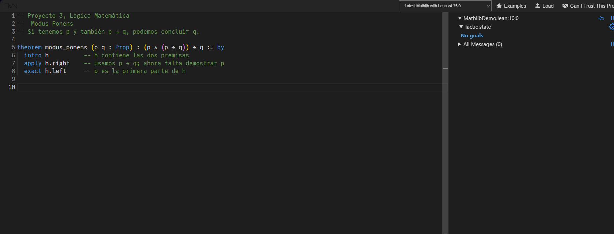

## Demostración: Modus Ponens

El código se encuentra en `ModusPonens.lean`. Usa el mismo estilo de tácticas que las otras demostraciones del proyecto y no necesita importar bibliotecas adicionales.

### Enunciado

La regla de Modus Ponens establece que, si tenemos p y también p → q, podemos concluir q. Como proposición se escribe:

**(p ∧ (p → q)) → q**

### Razonamiento en lenguaje natural

Supongamos que se cumple p ∧ (p → q). Por Simplificación (Simp) obtenemos p y obtenemos p → q. Como se cumple el antecedente de la implicación, aplicamos Modus Ponens y concluimos q. Por demostración condicional (Dem. c), queda demostrada la implicación inicial.

Por ejemplo, tomemos p como «entrego la tarea» y q como «recibo los puntos de entrega». Si sabemos que entrego la tarea y que, si la entrego, recibo esos puntos, entonces podemos concluir que recibo los puntos de entrega. La conclusión depende de contar con las dos premisas.

| Paso | Proposición | Justificación |
| --- | --- | --- |
| 1 | p ∧ (p → q) | Suposición |
| 2 | p | Simp 1 |
| 3 | p → q | Simp 1 |
| 4 | q | MP 2, 3 |
| 5 | (p ∧ (p → q)) → q | Dem. c: pasos 1–4 |

En los apuntes de Cuantificadores, la regla aparece en la página 6 con las premisas separadas: p ⇒ q y p, de donde se concluye q. En nuestro enunciado agrupamos esas dos premisas con una conjunción. Por eso, antes de aplicar MP, usamos Simplificación para obtener cada una.

### Código en Lean

```lean
theorem modus_ponens (p q : Prop) : (p ∧ (p → q)) → q := by
  intro h          -- h contiene las dos premisas
  apply h.right    -- usamos p → q; ahora falta demostrar p
  exact h.left     -- p es la primera parte de h
```

### Explicación del código

La primera línea declara un teorema llamado `modus_ponens`. `(p q : Prop)` indica que p y q son proposiciones cualesquiera. Después de los dos puntos aparece el enunciado y `by` inicia la demostración con tácticas.

Con `intro h` suponemos el antecedente de la implicación. Así obtenemos `h : p ∧ (p → q)` y la meta pasa a ser q.

Con `apply h.right` usamos la parte derecha de h, que es la implicación `p → q`. Como queremos demostrar q, Lean reduce la meta a demostrar p, que es lo que necesita esa implicación.

Finalmente, `exact h.left` proporciona la prueba de p que ya está en la parte izquierda de h. Esto resuelve la meta pendiente y completa la demostración.

| Momento | Hipótesis disponibles | Meta pendiente |
| --- | --- | --- |
| Antes de `intro h` | p y q declaradas como proposiciones | `(p ∧ (p → q)) → q` |
| Después de `intro h` | `h : p ∧ (p → q)` | `q` |
| Después de `apply h.right` | `h : p ∧ (p → q)` | `p` |
| Después de `exact h.left` | La hipótesis h | Ninguna |

### Capturas de la demostración

#### Paso intermedio



Después de `apply h.right`, Lean muestra una meta pendiente: p.
Esto ocurre porque, para obtener q mediante la implicación p → q,
necesitamos demostrar p. El mensaje “1 goal” corresponde a este
paso intermedio y no representa un error.

#### Demostración completa


Con `exact h.left` proporcionamos la prueba de p que está en la
primera parte de la hipótesis. El panel muestra “No goals” y
“All Messages (0)”, indicando que la demostración está completa.
La comprobación se realizó en el editor web con Lean 4.35.0.

### Relación con lo visto en clase

`intro h` corresponde a la suposición inicial de la demostración condicional. `h.left` y `h.right` permiten obtener las partes de la conjunción, como en Simp. Al usar una prueba de p → q junto con una prueba de p, obtenemos q, como establece MP. Las tácticas no tienen que llevar el mismo nombre que las reglas del curso para expresar ese razonamiento.

En Axiomática se usa ⊢ para indicar que una fórmula es un teorema. En esta demostración la conclusión q depende de las premisas: no estamos afirmando que cualquier q sea verdadera por sí sola. Lo que se demuestra para cualesquiera p y q es la implicación completa `(p ∧ (p → q)) → q`.

En papel primero obtenemos las dos premisas y después aplicamos la regla de inferencia. Con `apply`, en cambio, trabajamos desde la meta: para probar q usando p → q, buscamos una prueba de p. Aunque el orden de trabajo se ve distinto, el razonamiento es el mismo.

Una forma de revisar por qué hacen falta las dos premisas es cambiar, en una copia del archivo, `exact h.left` por `exact h.right`. En ese punto se necesita una prueba de p, pero `h.right` tiene tipo `p → q`, así que no resuelve la meta.

### Referencias

- Avigad, J., de Moura, L., Kong, S. y Ullrich, S. *Theorem Proving in Lean 4*, capítulos «Propositions and Proofs» y «Tactics».
  - https://lean-lang.org/theorem_proving_in_lean4/Propositions-and-Proofs/
  - https://lean-lang.org/theorem_proving_in_lean4/Tactics/

- Material de clase. *Axiomática*, pp. 2–3: Modus Ponens y demostraciones formales.
- Material de clase. *Cuantificadores*, pp. 6–7: MP, Simp y demostración condicional.
